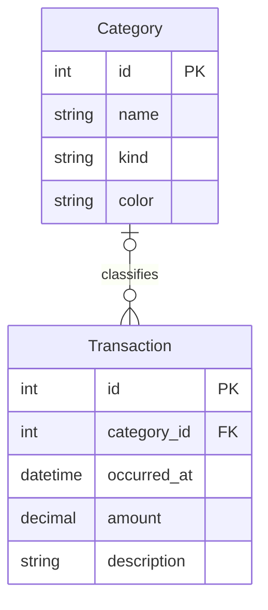

# Domain Model

Tracking bank transactions and expense statistics by category.

## Entities

- **Transaction** — a single operation (payment or income).
- **Category** — an expense/income category.

## Schema

